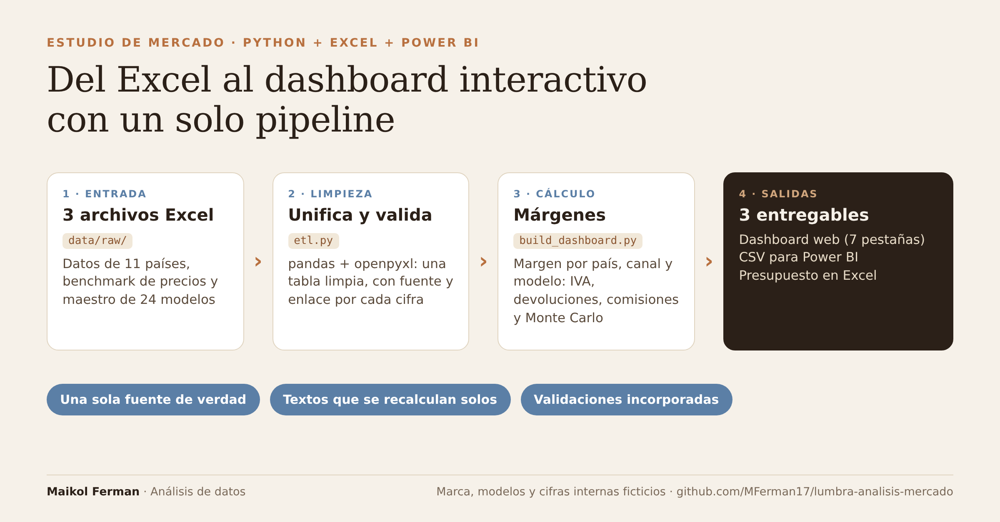

# LUMBRA FW27 — Estudio cuantitativo de mercado y precios

Pipeline en Python que alimenta un **dashboard web autocontenido**, un **kit de Power BI** y un **presupuesto a 2 años en Excel** para el lanzamiento de una marca de calzado en los mercados nórdico, DACH y Benelux (más un análisis específico de España).

> **Proyecto de portafolio con datos ficticios.** La marca «LUMBRA», los nombres de modelo, los costes, los PVP, el plan de compra y el presupuesto son inventados. Se basan en un caso real, pero ninguna cifra interna corresponde a una empresa. Los datos de mercado (Statista, Euromonitor, FashionUnited, Eurostat, FMI, BCE) y los precios de la competencia son de fuentes públicas, citadas fila por fila en los CSV y en las hojas de metodología.

**Autor:** Maikol Ferman · Análisis de datos



---

## Qué demuestra este proyecto

- **Una sola fuente de verdad.** Los Excel de `data/raw/` alimentan el HTML, los CSV de Power BI y el presupuesto. Nada se copia a mano entre entregables. Si cambia un coste o un PVP, se regenera todo con un comando.
- **Supuestos visibles.** Cada cifra se etiqueta como dato de fuente, dato del caso o supuesto editable (por ejemplo, los países sin tasa de devolución usan el promedio de los que sí la tienen y se marcan como estimación).
- **Textos que se recalculan.** Los hallazgos de la pestaña Ranking y las cifras del Simulador se calculan desde los datos en vez de escribirse a mano.
- **Validación incorporada.** El presupuesto incluye una hoja `Validacion` que cruza unidades vendidas contra el plan de compra y marca los desajustes.
- **Documentación reproducible.** La guía de Power BI incluye los valores de control que deben coincidir con los de la web.

## Estructura

```
lumbra-analisis-mercado/
├── data/
│   ├── raw/          # Excel de entrada (ficticios en lo interno, públicos en lo externo)
│   │   ├── LUMBRA_datos_cuantitativos_FW27.xlsx     # 10 países: PIB, mercado, devoluciones, IVA…
│   │   ├── LUMBRA_Benchmark_PVP_FW27_RANKING.xlsx   # Categorías, costes, PVP y benchmark de competencia
│   │   └── BuyPlan_Maestro_Modelos_Lumbra.xlsx      # 24 modelos con coste, PVP y pares (ficticio)
│   └── processed/    # CSV generados (no editar a mano)
├── src/
│   ├── etl.py                 # Limpia el Excel de mercado → lumbra_datos_limpios.csv
│   ├── analysis.py            # Modelo TAM-SAM-SOM exploratorio
│   ├── charts.py              # Gráficos rápidos de revisión
│   ├── montecarlo.py          # Simulación Monte Carlo del margen (CLI)
│   ├── build_dashboard.py     # Script principal: genera docs/index.html y los CSV de Power BI
│   ├── build_presupuesto.py   # Genera el Excel de presupuesto a 2 años
│   ├── dashboard_template.html
│   └── vendor/chart.umd.js    # Chart.js local: el dashboard funciona sin internet
├── docs/index.html            # Dashboard final (se publica con GitHub Pages)
├── output/                    # Presupuesto en Excel y gráficos PNG
└── powerbi/                   # Guía de modelo, medidas DAX, tema y kit de páginas
```

## El dashboard (7 pestañas)

1. **Resumen** — PIB, poder de compra, cuota de lujo y mapa de oportunidad por país.
2. **Simulador de producto** — margen por unidad por país y canal (online / presencial B2B), en modo valor fijo y Monte Carlo.
3. **Competencia** — PVP de la colección frente a las marcas reales del benchmark, con presencia online y física verificada.
4. **Ranking de modelos** — margen por modelo y por país, con la matriz completa.
5. **España** — mercado online, devoluciones, canal multimarca y margen por canal.
6. **Tendencias por país** — categoría de calzado dominante y tendencia de botas altas.
7. **Explorar datos** — todas las cifras del estudio con su fuente y enlace.

## Cómo ejecutarlo

```bash
python -m venv .venv
source .venv/bin/activate          # Windows: .venv\Scripts\activate
pip install -r requirements.txt

python src/etl.py                  # data/processed/lumbra_datos_limpios.csv
python src/build_dashboard.py      # docs/index.html + CSV de Power BI
python src/build_presupuesto.py    # output/presupuesto/LUMBRA_Presupuesto_2anios.xlsx
```

Para actualizar precios o costes: edita el Excel correspondiente en `data/raw/` y vuelve a correr `build_dashboard.py`. El multiplicador wholesale (2,5x), la comisión del agente B2B (12 %) y el coste medio de transporte (2,40 €/par) son constantes al inicio de `build_dashboard.py`; se inyectan solas en el Simulador y en la pestaña España.

Monte Carlo es una foto estática de un escenario, no una vista en vivo:

```bash
python src/montecarlo.py --pais Suecia --precio 159 --coste 38 --tasa-min 18 --tasa-max 25 --coste-devolucion 13
```

## Fórmula de margen

Por unidad y país: ingreso neto = PVP ÷ (1 + IVA). Margen = ingreso neto − (coste + aprovisionamiento) − devolución × ingreso neto − devolución × coste logístico de la devolución. En el canal presencial, el precio es coste × multiplicador wholesale, menos la comisión del agente sobre el ingreso neto y el transporte por par.

## Límites a tener en cuenta

- **El mapa de oportunidad mezcla definiciones de mercado** (eCommerce total, Fashion eCommerce, Luxury Goods, Apparel) de años distintos, porque no había un único indicador por país. Cada burbuja lleva su etiqueta y el dashboard avisa de que no son comparables entre sí.
- **El modelo TAM-SAM-SOM es exploratorio**: parte de apparel y cuota de lujo, no del mercado de calzado accesible.
- **La banda Monte Carlo (±4 pp)** alrededor de la tasa de devolución es un supuesto editable, no una distribución observada.
- **Varias tasas de devolución son secundarias o estimadas** (Prime AI, ZigZag + Retail Economics) y se marcan como tales.
- **El presupuesto es un modelo de escenarios**, no un forecast validado: las unidades por país son supuestos y el flujo de caja es simplificado.
- **El `.pbix` no se incluye** (binario propietario). `powerbi/` documenta cómo reconstruirlo.

## Fuentes y licencias de datos

Las cifras de Statista Market Insights, Euromonitor y FashionUnited se citan con su fuente y año; son datos de terceros y mantienen sus propios términos de uso. Los precios de competencia son PVP públicos consultados en agosto de 2026. Los datos internos de la marca (modelos, costes, PVP, unidades, presupuesto) son ficticios.
